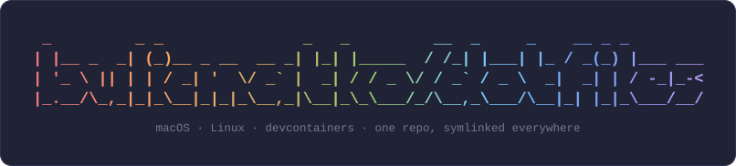
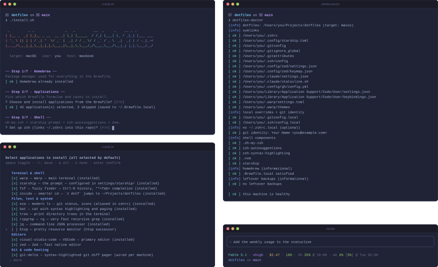
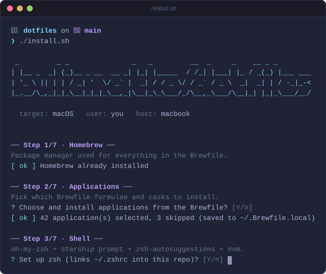
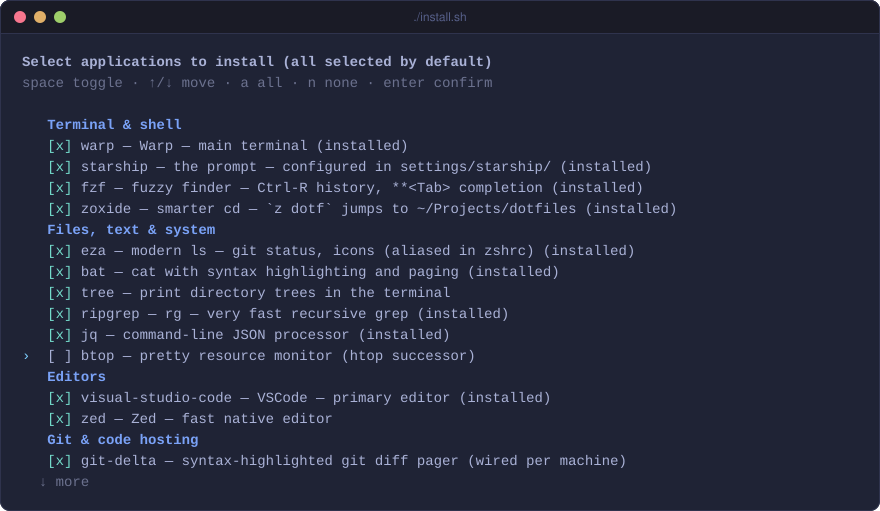
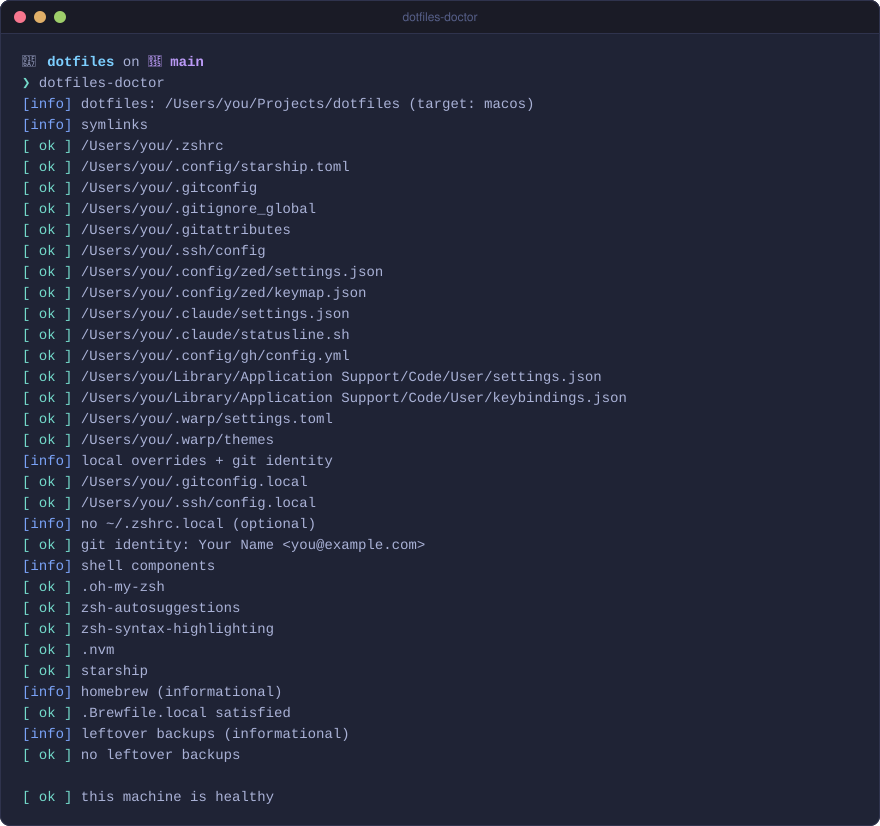
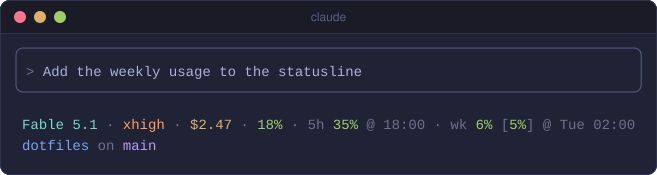
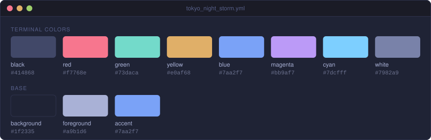

<p align="center">
  
</p>

[](https://github.com/bulicmatko/dotfiles/actions/workflows/ci.yml)

Personal dotfiles — the single source of truth for every machine I use:
macOS laptops, Linux boxes, and devcontainers.

Everything is **symlinked** from this repo into place, so editing a setting in
any tool changes the file _in this repo_. Commit and push on one machine,
pull on another — done.

The repo contains **no personal identity**: the installer asks for a git
name/email on first run and stores them in untracked `~/.gitconfig.local`,
and app choice is a per-machine pick from the Brewfile. Anyone can use these
dotfiles as-is.

<p align="center">
  
</p>

## Setup

```sh
git clone https://github.com/bulicmatko/dotfiles.git ~/Projects/dotfiles
cd ~/Projects/dotfiles
./install.sh
```

`install.sh` detects the platform (or force one with
`./install.sh macos|linux|devcontainer`), is safe to re-run any time, and
backs up files it would overwrite as `<name>.backup.<timestamp>`.

## Guided installer

Numbered steps that ask before running (Enter = yes). Without a TTY there are
no prompts: every step runs and the full Brewfile is installed, so unattended
setups never hang.

<p align="center">
  
</p>

On macOS it installs Homebrew and the [Brewfile](Brewfile), oh-my-zsh with
the starship prompt and nvm, links the zsh, git, ssh, editor, Warp, Claude
Code, and GitHub CLI config, generates an ed25519 SSH key with its passphrase
in the Apple keychain (add the printed public key to
[GitHub](https://github.com/settings/keys)), and applies system settings from
[os/macos/defaults.sh](os/macos/defaults.sh) — keyboard, Finder, Dock,
screen saver, login items. Linux gets the same shell, git, and editor setup
via apt; devcontainers a headless subset (zsh, starship, git).

## App picker

The [Brewfile](Brewfile) lists _every_ app and CLI, and the installer turns
it into a checkbox picker so each machine installs only what it needs. Space
toggles, ↑/↓ move, `a` selects all, `n` selects none, Enter confirms.

<p align="center">
  
</p>

The selection is saved to `~/.Brewfile.local`, so apps you skipped stay
skipped on updates. Re-run `./install.sh` to change it.

## Staying in sync

Tweak a setting inside VSCode, Zed, or Warp and the file in this repo
changes — commit, push, and `git pull` on the other machine. Keep the tools'
own settings sync off so the repo stays the source of truth.

Two commands live in `bin/`, which `zshrc` puts on PATH:

```sh
dotfiles-update   # pull the repo, update Homebrew, oh-my-zsh, symlinks, extensions, macOS settings
dotfiles-doctor   # check every symlink, the git identity, and shell components
```

<p align="center">
  
</p>

## Claude Code status line

[statusline.sh](settings/claude/statusline.sh) shows the model, effort,
session cost, and context use, then claude.ai plan usage for the 5-hour and
weekly windows with the time each one resets, and the folder and branch on a
second line. Effort takes the colors of Claude Code's effort picker, and max
shows as a flexing ᕦ(ò_óˇ)ᕤ in a rainbow. Colors turn yellow and red as context
and usage near their limits.

<p align="center">
  
</p>

## Theme

Warp, Zed, and VSCode share the Tokyo Night Storm palette, defined for Warp in
[tokyo_night_storm.yml](settings/warp/themes/tokyo_night_storm.yml).

<p align="center">
  
</p>

## Devcontainers

VSCode's `"dotfiles.repository": "bulicmatko/dotfiles"` (already in
[settings/vscode/settings.json](settings/vscode/settings.json)) clones this
repo into every container and runs `install.sh`. For the project side, copy
the [node](devcontainer/node/devcontainer.json),
[bun](devcontainer/bun/devcontainer.json), or
[go](devcontainer/go/devcontainer.json) template to
`<project>/.devcontainer/devcontainer.json`.

## Machine-specific overrides

Untracked files, included last so they win over the synced config:

| File                  | Purpose                                                        |
| --------------------- | -------------------------------------------------------------- |
| `~/.gitconfig.local`  | commit identity + git overrides (work email, credential helper) |
| `~/.zshrc.local`      | extra shell config, sourced at the end of `zshrc`              |
| `~/.ssh/config.local` | private SSH hosts (VPS IPs, work jumphosts)                    |
| `~/.Brewfile.local`   | this machine's app selection from the Brewfile                 |

## License

Released under the [MIT License](LICENSE) — use, copy, and adapt freely.

---

<p align="center">
  Built with ❤️ by <a href="https://github.com/bulicmatko">🙋🏻‍♂️ Matko</a>
  and <a href="https://claude.com/claude-code">🤖 Claude</a>
</p>
